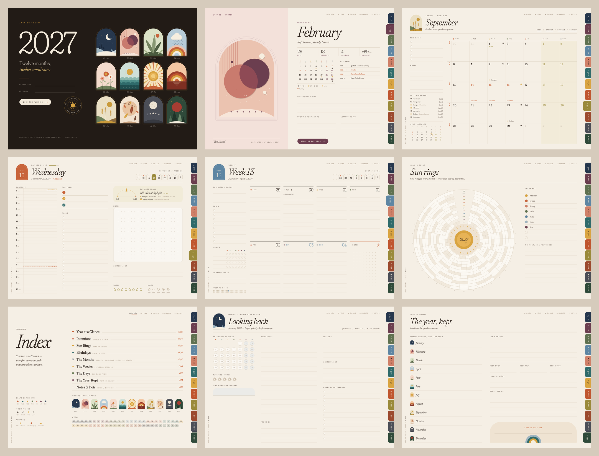

# Atelier Soleil 2027 — GoodNotes 디지털 플래너 (완전판)



가로형 아이패드(4:3, 1366×1024)에 맞춘 하이퍼링크 디지털 플래너입니다.

- **파일**: `Atelier-Planner-2027.pdf` (475쪽, 내부 링크 17,936개, 모두 벡터, 약 35MB)
- **콘셉트**: 미드센추리 컷페이퍼 아트. 열두 달마다 고유 색 팔레트와 아치 창 일러스트가 있습니다.

## 구성
| 구간 | 페이지 |
|---|---|
| 앞부분 | 표지(12개 아치 갤러리 + 에디션 실) · 목차(월 아치, 53주 바로가기) · 연간 달력 · 올해의 목표 · Sun Rings(연간 컬러 트래커) · 생일·기념일 |
| 매달 × 12 | 월 오프너(아트, 이번 달 숫자, 주요 날짜) → 월간 달력 → 해빗 트래커 → … → 월말 회고 |
| 주간 × 53 | 2026년 53주(12/28)부터 2027년 52주까지, 해당 주의 일간 페이지 바로 앞에 배치 |
| 일간 × 365 | 1월 1일부터 12월 31일까지 |
| 뒷부분 | 연말 회고(The Year, Kept) · 줄 노트 · 도트 노트 |

## 매일 바뀌는 데이터 (모두 한국 시간, `almanac.py`로 계산)
- **서울 일출·일몰과 낮 길이:** 전날 대비 증감과 함께, 일정표 위에도 표시
- **24절기:** 해당일, 진행 중인 절기, 다음 절기
- **달 모양:** 2027년 실제 달 위상
- **공휴일:** 한국 공휴일과 대체공휴일 (대체공휴일은 현행 규정으로 계산)

## 내비게이션
- **어느 페이지에서나:** 오른쪽 월 탭, 상단 메뉴(Index / Year / Goals / Habits / Notes)
- **일간:** 이전·다음 날 버튼, 그 주 7일 바로가기, 월·주 경로
- **주간:** 이전·다음 주 버튼, 52주 진행 바(각 칸이 그 주로 링크)
- **월간:** 모든 날짜는 일간으로, W 번호는 주간으로 연결
- **PDF 북마크:** 월 › 주 › 일 계층. GoodNotes의 목차(Outline) 패널에서 바로 이동할 수 있습니다.

## GoodNotes에서 쓰는 법
1. PDF를 아이패드로 옮긴 뒤 **공유 → GoodNotes로 열기** (또는 GoodNotes에서 **가져오기**).
2. 링크는 **읽기 모드**(펜 도구를 끈 상태)에서 탭하면 이동합니다.

## 다시 빌드하기
```bash
python3 build.py                 # planner.html 생성 (475쪽)
node render.js                   # PDF 렌더링 (--previews=id,id 로 미리보기)
python3 fixlinks.py              # 링크를 페이지 직접 이동 방식으로 변환 + PDF 북마크
```
글꼴: Fraunces, Jost (SIL Open Font License). 달 위상: `moon2027.json`, 절기·공휴일·일출몰: `almanac.py` (ephem).
