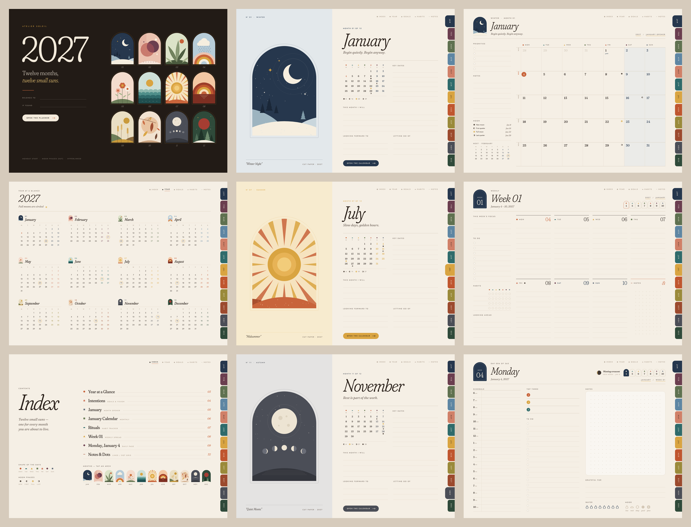

# Atelier Soleil 2027 — GoodNotes 플래너 샘플



가로형 아이패드(4:3, 1366×1024)에 맞춘 하이퍼링크 디지털 플래너 샘플입니다.

- **파일**: `Atelier-Planner-2027.pdf` (33쪽, 링크 663개, 모두 벡터)
- **콘셉트**: 미드센추리 컷페이퍼 아트. 열두 달마다 고유 색 팔레트와 아치 창 일러스트가 있습니다.
- **구성**: 표지(12개 아치 갤러리) · 목차 · 연간 달력 · 올해의 목표 · 월 오프너 12장 · 월간 12개월 · 해빗 트래커 · 주간 · 일간 · 줄 노트 · 도트 노트
- **디테일**: 요일별 도형 아이콘, 2027년 실제 달 위상(한국 시간), 일간 페이지의 오늘 달 모양
- **링크**: 오른쪽 월 탭, 상단 메뉴(Index / Year / Goals / Habits / Notes), 목차, 표지 아치, 주차·날짜 링크

## GoodNotes에서 쓰는 법
1. PDF를 아이패드로 옮긴 뒤 **공유 → GoodNotes로 열기** (또는 GoodNotes에서 **가져오기**).
2. 링크는 **읽기 모드**(펜 도구를 끈 상태)에서 탭하면 이동합니다.

## 다시 빌드하기
```bash
python3 build.py                 # planner.html 생성
node render.js --previews        # PDF + previews/*.png
python3 fixlinks.py              # 링크를 페이지 직접 이동 방식으로 변환
```
글꼴: Fraunces, Jost (SIL Open Font License). 달 위상: `moon2027.json` (ephem으로 계산).
